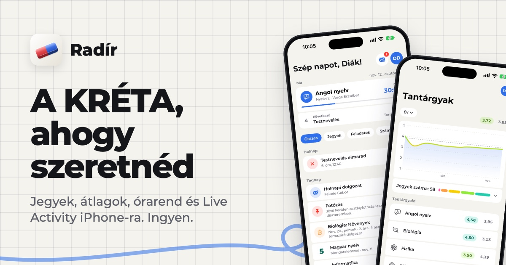
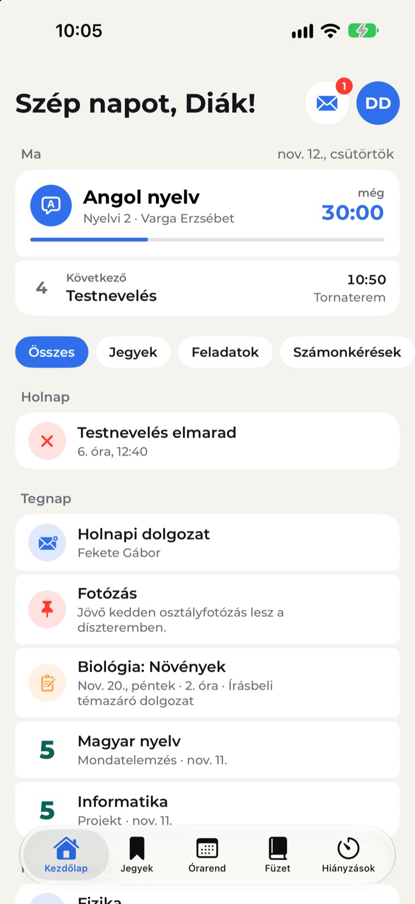
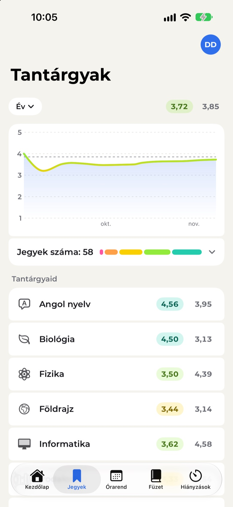
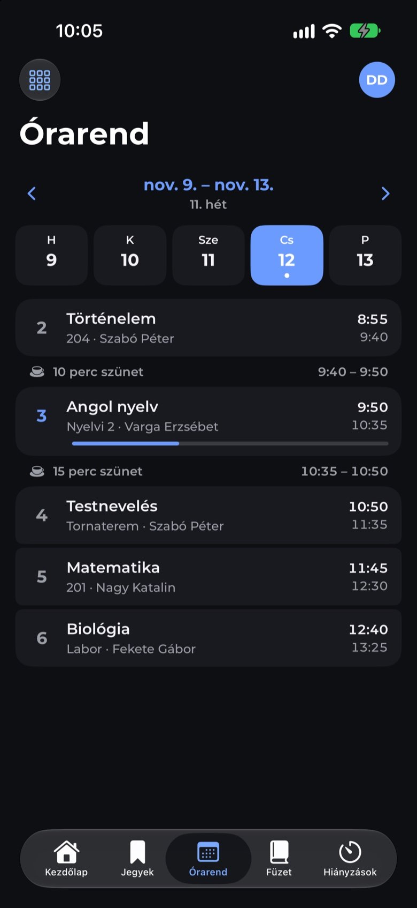
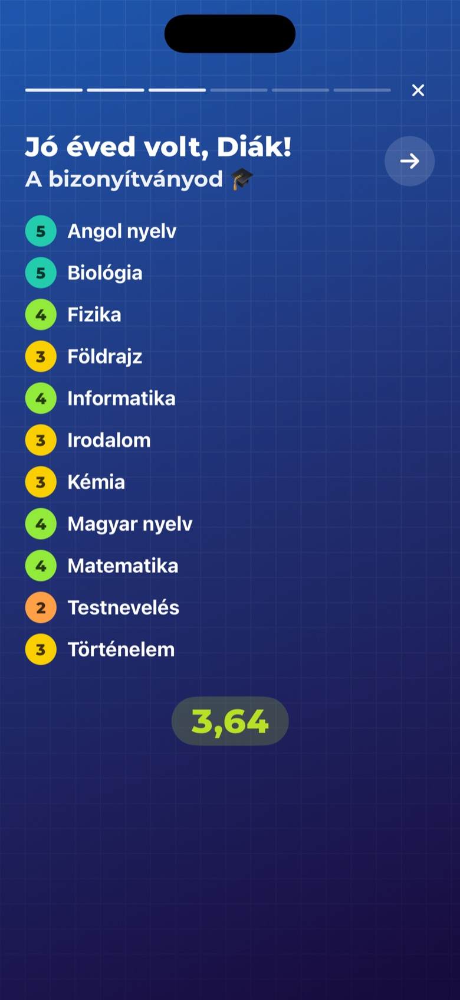

<div align="center">
  
</div>

<h1 align="center">Radír</h1>

<p align="center">
  <a href="LICENSE"></a>
  
  
  
  
  <a href="https://github.com/B3ni15/radir/stargazers"></a>
</p>

<p align="center">
  Nem hivatalos, natív iOS e-KRÉTA kliens. Jegyek, átlagok, órarend, házi feladatok és üzenetek egy gyors, szép appban — iOS 18-tól (iOS 26-tól Liquid Glass), ingyen, reklám nélkül, nyílt forráskóddal.
</p>

<p align="center">
  A belépés a KRÉTA saját oldalán történik: a jelszavadat a Radír nem látja és nem tárolja, a kapott tokenek pedig csak a telefonod kulcskarikájában vannak. Az iskolai adatokat az app közvetlenül a KRÉTA szervereiről olvassa, és csak helyben gyorsítótárazza.
</p>

## Mit tud

- **Jegyek és átlagok** — évközi és félévi jegyek, osztályátlag, céltervező, JSON export
- **Órarend** — napi és heti nézet, helyettesítések, elmaradó órák, **Live Activity** a zárolt képernyőn
- **Házi feladatok, dolgozatok, hiányzások, üzenetek** — minden egy helyen
- **Szépítés** — megosztható színek és témák, több fiók, sötét mód
- **Demó mód** — valódi fiók és hálózat nélkül is kipróbálható

<table>
  <tr>
    <td align="center"><b>Kezdőlap</b><br></td>
    <td align="center"><b>Jegyek</b><br></td>
    <td align="center"><b>Órarend</b><br></td>
    <td align="center"><b>Összefoglaló</b><br></td>
  </tr>
</table>

## Felépítés

- `Radir/` — az app: SwiftUI nézetek, `AppModel`, bejelentkezés, Live Activity
- `RadirKit/` — helyi Swift package: KRÉTA login és kliens, fiókok, színek, szerver API
- `web/` — landing page, várólista Worker, adatvédelem és [nem hivatalos KRÉTA API-dokumentáció](web/public/kreta-api/index.html)

## Futtatás

```bash
xcodebuild -project Radir.xcodeproj -scheme Radir -destination 'generic/platform=iOS Simulator' -derivedDataPath DerivedData build
```

Vagy nyisd meg a `Radir.xcodeproj`-ot Xcode-ban. A `RadirKit` tesztjei:

```bash
cd RadirKit && swift test
```

A bejelentkező képernyőn a **„Kipróbálom demóval”** gombbal fiók és hálózat nélkül is végignézhető az app.

## Licenc és köszönet

**AGPL-3.0** — a teljes szöveg a [LICENSE](LICENSE) fájlban. A betűkészlet Montserrat (SIL Open Font License 1.1, lásd `Radir/Fonts/OFL.txt`).

A Radír a **Filc → reFilc → Firka** nyílt forrású munkájára épül — köszönjük minden fejlesztőjüknek. Nem hivatalos alkalmazás; a KRÉTA az önkormányzati intézmények hivatalos rendszere.
